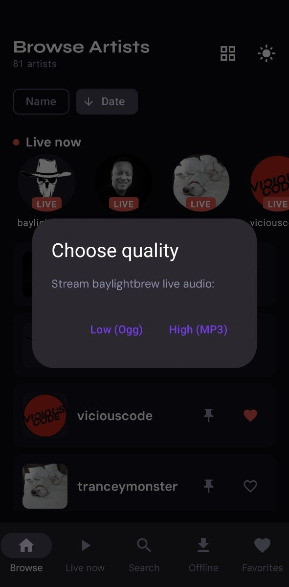
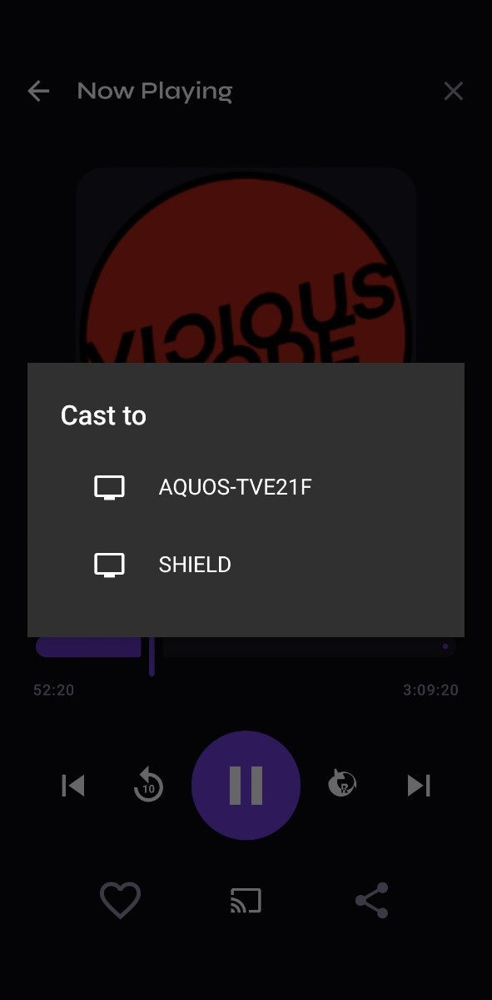
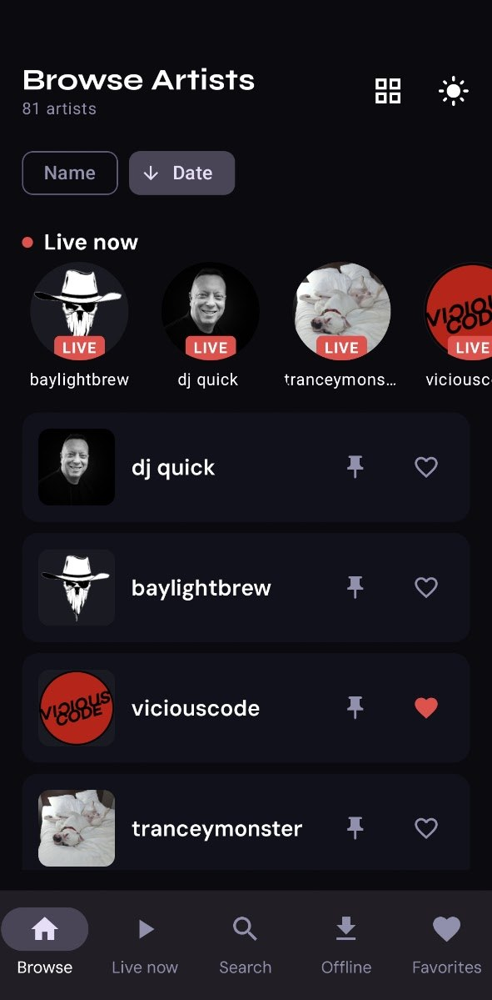
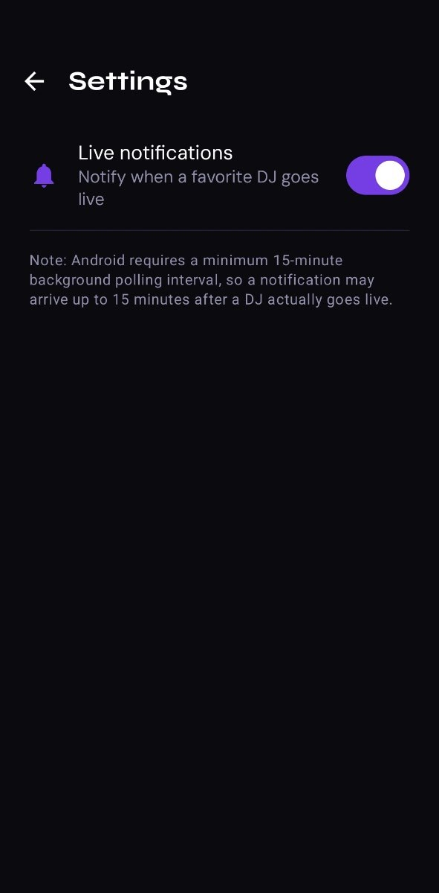
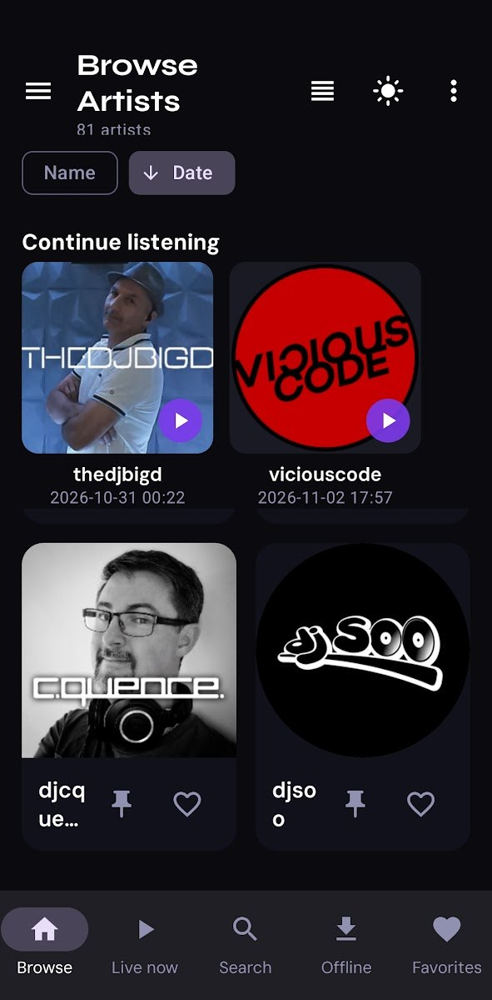
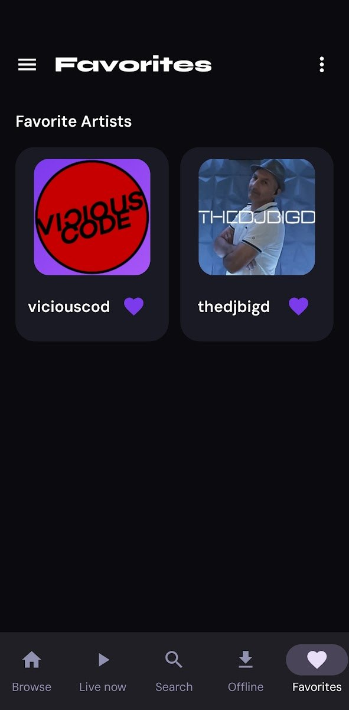

<div align="center">

# STArchive Player

**Stream DJ sets from ST Archive — on your phone and in the car.**

_Android app · Kotlin · Jetpack Compose · Media3/ExoPlayer · Android Auto_

</div>

STArchive Player is a native Android music player for the [ST Archive](https://starchive.streambox.space) — a community of Twitch DJs (team Stellar Transmissions). Browse every DJ, stream their sets, tune into who's live right now, download sets for offline listening, and control it all from the car.

> Full overview: **[ABOUT.md](ABOUT.md)** · Upcoming work: **[FEATURES-ROADMAP.md](FEATURES-ROADMAP.md)**

## What's new in 1.5.3

- **App-only volume** — a volume slider on the player that only affects STArchive (never the system volume); it's remembered between sessions.
- **Home-screen widget** — a mini-player for your launcher: shows the current track + artwork, with **Play/Pause** and **Skip** straight from the home screen (Skip auto-plays the next track; hidden on live) and tap-to-open the app. Stays in sync live with playback.
- **Shuffle** — on/off toggle on the player.
- **Live row on an artist page** — when a DJ is live, their newest (in-progress) recording is replaced by a **LIVE** card that plays their stream in one tap (High/Low quality). It's excluded from the queue and from "Continue", so playback never tries the unwritten file.
- **Up-Next queue** — pull up the queue from the player: reorder (↑/↓), remove, jump to a track, or Clear all.
- **Track count** — each artist page shows how many tracks are in the list.
- **Live tab** — your favourite DJs are pinned to the top (♥), and the tab is now list-only for a cleaner layout.

---

## What's new in 1.5.2

- **Browse (thumbnail grid)** — two artists per row for bigger, cleaner cards; the About-DJ "i" icon moved off the grid cards (still available in list view). Favorite heart stays on every card.

---

## What's new in 1.5.1

- **Cast button fixed** — now a proper Compose button that's visible on all devices, including tablets.
- **Tablet & landscape layout pass** — artist thumbnails are half the size in grid views (Browse, Live, Favorites); player artwork is smaller in landscape so the controls always fit on screen; a **Stop** button sits beside play/pause.
- **Grid ↔ list view** — Browse, Live Now, and Favorites now toggle between a dense thumbnail grid and a compact list.
- **Continue listening** — smaller cards, and long-press any card to **Remove** just that track or **Clear all**.
- **Rotation fix** — rotating the device no longer jumps back to a previously-played track; playback and resume point stay where you left them.
- **Playback stability** across the board.

---

## Screenshots

<div align="center">








</div>

---

## Download

Grab the latest Android app. The links below always point to the most recent build — no need to hunt for a version.

- **Latest debug APK:** [STArchivePlayer-debug.apk](https://github.com/Tarada42/starchive-player/releases/latest/download/STArchivePlayer-debug.apk) (fast iteration build; ideal for daily use)
- **All releases / release notes:** [Releases](https://github.com/Tarada42/starchive-player/releases)

> Sideloading must be enabled on your device (Settings → Security → Install unknown apps). Allow the install from wherever you opened the file.

---

## Features

- **Browse & stream** every DJ's recorded sets (audio-only MP4) — grid or list view with date/name sorting
- **Live now** — see who's broadcasting right now and tune in instantly, with High (MP3) / Low (Ogg) quality choice where available
- **Favourites** for artists and individual sets
- **Resume playback** — picks up your last track + position, per DJ
- **Single Artist mode** — pin a DJ and focus the whole app on them
- **Offline downloads** — save sets (multi-select) and play with zero data
- **Cast** — stream live (MP3 & Ogg) and archive sets to Chromecast/Google Cast devices from the phone app; track switches follow the device, and stopping a cast resumes the last track locally
- **Search** with persistent recent searches
- **Hamburger drawer & overflow menu** — Settings and About (app version, Twitch/Discord/web links) from the phone app
- **Android Auto** — full media module with Artists / Live / Favourites tabs, artist grid/list toggle, sort cycling, quality picker, and a plain-list player with -10 s / +10 s / play-pause / stop
- **Background playback** with notification + lock-screen controls

---

## Tech Stack

Kotlin · Jetpack Compose (Material 3) · Media3/ExoPlayer + `MediaLibraryService` · Google Cast · OkHttp · jsoup · Coil · Jetpack DataStore

- **Min SDK:** 26 · **Target SDK:** 35
- JDK 21 required to build

---

## Getting Started

```bash
git clone <this-repo-url>
./gradlew assembleDebug
```

Install on a connected device:

```bash
adb install -r app/build/outputs/apk/debug/STArchivePlayer-1.5.3-debug.apk
```

The APK is auto-named `STArchivePlayer-<version>-<buildType>.apk` (e.g. `STArchivePlayer-1.5.3-debug.apk`). To share a build with the public, attach it to a GitHub Release using the **stable filename** `STArchivePlayer-debug.apk` — the Download link above stays correct automatically.

---

## Android Auto: setup & testing

1. Build and install the app on a phone (see above).
2. Install the **Android Auto** app from the Play Store, or use the **Desktop Head Unit (DHU)** from the Android SDK's `extras/google/auto` package to test without a car. Note: DHU has no real audio sink — silence there is normal.
3. Enable developer settings in Android Auto (tap the version number ~10×) and turn on **Unknown sources** so a non-Published build is allowed to appear.
4. Connect the phone (USB, or the DHU via `adb forward`) and open Android Auto — the STArchive icon appears under media apps with **Artists / Live / Favourites** tabs.

The AA module is clean-room and phone-parity-driven: it shares only the `Repository` data layer with the phone app and never uses the phone UI or casting.

---

## Design

The look is matched to the STArchive web app palette:

- Background `#0A0A0F`, surface `#11111C`, card `#1A1A24`
- Primary violet `#7C3AED`, secondary `#A855F7`, green `#22C55E`, red `#EF4444`
- 2-column grid of square artist cards with Twitch avatar / gradient placeholder, name, favourite toggle, and date/name sort
- Bottom navigation: Browse, Live now, Search, Offline, Favourites
- Hamburger drawer (top-left) and 3-dot overflow menu (top-right) both expose Settings and About

---

## Community

Android player for the music archive for members of Twitch team **Stellar Transmissions**.

- **Discord:** https://discord.gg/xg9yEAv
- **Web app:** https://webapp.streambox.space/

---

## License

Released under the [MIT License](LICENSE).

<div align="center">

**Built for the ST Archive community**

_Vibecoded using Birgitte The Bot, under direction of NickTheD_

</div>